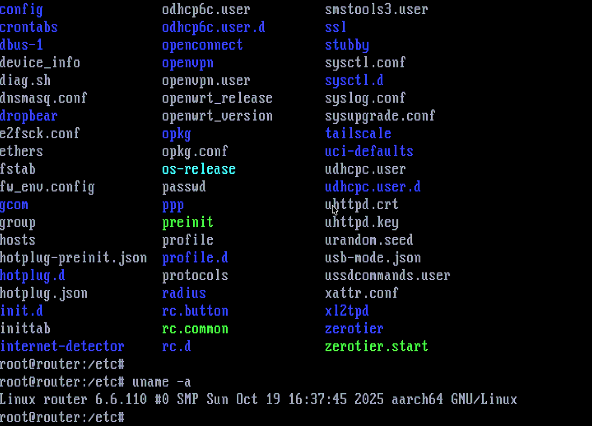

# DOSSSH

DOSSSH is an SSH terminal for MS-DOS. It runs in 16-bit real mode on a 386 or
newer PC, using mTCP and a packet driver. No DOS extender is needed.



## Background

An old DOS PC can get on Wi-Fi through a small OpenWrt router: Ethernet to the
PC, Wi-Fi to the network. This works well until I need to change the access
point or the password of a phone hotspot. Then I need to configure the router
from the DOS machine.

I tried setting up plain Telnet access, but it did not work particularly well,
and it was not secure either. SSH was the obvious alternative, except that I
needed an SSH client for DOS.

I tried two versions of SSH2DOS. Neither worked on my setup, and each failed
with a different error. Having already written
[FTP2P](https://github.com/radozd/ftp2p) and worked with terminal software, I
decided to write a small SSH client myself.

There is also a less practical reason: connecting from a decades-old PC to a
modern SSH server and working in a terminal is simply fun.

Like FTP2P, DOSSSH has a narrow purpose. It is an interactive SSH terminal,
not a file transfer client, a DOS Unix shell or a general-purpose network
suite.

## Features

- SSHv2 terminal with VT100/xterm-style screen emulation
- password and keyboard-interactive authentication
- Ed25519 host key verification, with remembered trusted keys
- encrypted sessions with automatic rekeying
- UTF-8 support for DOS code pages 437, 850, 858, 852 and 866
- optional connection debug log

## Requirements

- MS-DOS 5.0 or later
- 386 or newer PC (no math coprocessor required)
- network adapter with an mTCP-compatible packet driver
- working mTCP configuration and a compatible SSH server

## Usage

Load your packet driver, configure mTCP and run DOSSSH:

```bat
SET MTCPCFG=C:\MTCP.CFG
DOSSSH.EXE 192.168.1.1 -u root
```

Command line:

```text
DOSSSH <host[:port]> [-u user] [-debug]
```

The default port is 22. Omit `-u` to enter the username at the prompt. The
password is always entered interactively. Press **Alt+X** to disconnect.

On the first connection, DOSSSH shows the server's Ed25519 fingerprint. **Check
it against a trusted source before typing `yes`.** If a known host key changes,
DOSSSH warns, shows both the stored and new fingerprints, and only replaces
that host's saved key after you independently verify the new fingerprint and
type **`override`** (not `yes`). Enter anything else to refuse the connection.

For the original OpenWrt use case (changing a phone hotspot or upstream access
point over an Ethernet connection), see [OPENWRT.MD](OPENWRT.MD).

## Random numbers on DOS

SSH needs unpredictable random numbers, but DOS has no system cryptographic
random-number generator. DOSSSH collects its own input before connecting.

It mixes system clock timings (including the high-resolution PIT timer) with
BIOS, ROM and video memory state. When raw disk access is available on a
FAT12/FAT16 volume, it also mixes disk metadata, sector contents and read
timings. Disk access is read-only. Passive machine state and disk contents
are not assumed secret or unpredictable.

On the first run, with no saved seed, DOSSSH also asks for live input:

- Irregular mouse movements and their timing. A DOS mouse driver is required.
- Irregularly timed keypresses (up to 32, depending on mouse activity).
  **Esc** cancels the setup.

The collected data is mixed with SHA-256 and used to initialize an HMAC-DRBG
random generator. DOSSSH saves a new seed in `C:\DOSSSH.DAT`, or on the drive
from which it was launched (`A:` or `B:`) if `C:` is unavailable. On later runs,
it mixes the saved seed with fresh observations and replaces it with a new
one, normally without asking for more mouse or keyboard input.

`DOSSSH.DAT` also stores the trusted SSH host keys. It is a plain-text file
and must remain writable. Do not distribute it or copy it between machines.
If it is corrupt, inaccessible or cannot be updated, DOSSSH refuses to
connect rather than proceed without a usable saved state.

This collection method is a practical compromise for old hardware, not a
certified source of cryptographic randomness. Disk timings and mouse
movements may be predictable in emulators or cloned systems; variation
checks cannot prove how much entropy was collected.

## Limitations

DOSSSH supports `curve25519-sha256`, `ssh-ed25519`, `aes128-ctr` and
`hmac-sha2-256`. Servers must offer these algorithms. There is no public-key
user login, SCP, SFTP, port forwarding or SSH agent support. Terminal emulation
covers a useful subset of VT100/xterm, not every feature.

The cryptographic code has not had an independent security audit. Treat DOSSSH
as an experimental hobby tool, not a security-hardened SSH client.

**Never use `-debug` for a normal session.** It writes secret session keys to
`DOSSSH.LOG`. Do not share the log.

## Status

DOSSSH has been tried on a real 486DX2/66 and in DOSBox emulating a 386/20.
It has not yet been tested on a physical 386.

## Build

DOSSSH is built with Open Watcom 1.9. See [BUILDING.MD](BUILDING.MD).

The `DOSSSH/` directory contains the application sources, `mTCP/` contains the
networking sources, and `DIST/` contains the short DOS readme and license.

## Origin and license

DOSSSH uses [mTCP](https://github.com/mbbrutman/mTCP) by Michael B. Brutman,
reuses parts of FTP2P, and draws on SSH2DOS and public-domain Ed25519 code.
See [ORIGIN.MD](ORIGIN.MD) for the credits.

DOSSSH is distributed under GPL v3 or later. mTCP retains its own licensing
notices. See `LICENSE` and `mTCP/LICENSE`.
